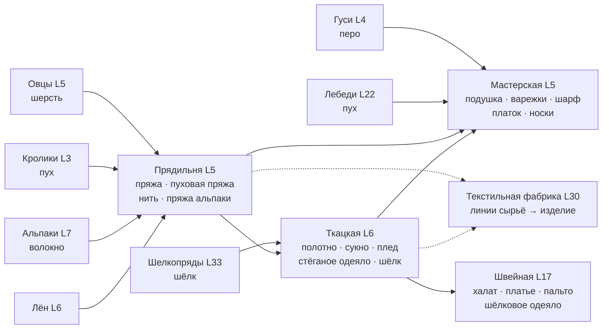

# Текстильная цепочка фермы: от овцы до фабрики

Статус: проект (Opus), 2026-10-22. Код не менялся. Решения по балансу и объёму — за владельцем (раздел 14).
Источник: отзыв владельца 2026-10-21, пункт B3 (`FARM_FEEDBACK_2026-10-21.md`), ответ 5: «нужна вся цепочка».

## 0. Главное

- Сейчас текстиль есть, но он короткий и невыгодный. Пряжа делается одним шагом в «Мастерской»
  (`loom`): 68 монет добавленной стоимости в час. Шарф даёт 48 в час, подушка — 53. Закон ценности
  мастерских на тех же уровнях — 180–190 в час. Поэтому любимые вещи кошки Сони почти не делают.
- Предлагаем две новые постройки: **Прядильня** (L5, волокно → пряжа и нить) и **Ткацкая** (L6, нить →
  полотно, сукно, плед, стёганое одеяло). Вязание, набивка и букеты остаются в «Мастерской». Шитьё —
  в существующей «Швейной мастерской» (L17). Позже, с L30, — **Текстильная фабрика**: линии с бункером.
- Цены существующих `ITEMS` не меняются. 11 новых товаров, 14 новых рецептов (в том числе шарф из
  пряжи альпаки рядом со старым); у одного старого — подушки — меняются входы и время. Каждый шаг выведен на закон ценности, и цепочка целиком
  даёт столько же в час, сколько соседние мастерские. Новой «печатной машинки» монет нет.
- По умолчанию изменения **только добавляются** (вариант «а»): старые рецепты пряжи и полотна на
  станке остаются, миграции состояния нет. Перенос с чисткой памяти рецептов (вариант «б») описан
  в разделе 10 как альтернатива.
- Прогон симулятора на пропатченном каталоге (90 дней): у active и casual темп не изменился
  (active L50 69,0 → 69,0 дня). Online быстрее на 2,6% (L50 35,1 → 34,2). Доля мастерских в доходе
  выросла на 0–1 п. п. Симулятор сам строит прядильню и ткацкую.
- Узкое место — сырьё, а не время мастерской. При двух визитах в сутки овчарня даёт 4–12 шерсти
  в сутки, а прядильня может переработать 24–40. Поэтому цепочка «тянет» расширение пастбища,
  улучшения домиков и помощников-скотников. Фабрика тем более.
- Соня получает фирменные заказы на текстиль, как Медведь Пух — на энергетики (50% её заказов,
  с потолком количества для дорогих вещей), расширенный список любимых вещей и домашний проект
  «Уголок Сони».

## 1. Что есть сейчас

| звено | что в каталоге | где |
|---|---|---|
| сырьё | шерсть (овцы L5, 25), кроличий пух (L3, 28), гусиные перья (L4, 22), волокно альпаки (L7, 36), лён (культура L6, 24), мохер (ангорки L18, 108), лебяжий пух (L22, 130), шёлковая нить (шелкопряды L33, 235), шерсть яка (L37, 341) | `catalog.py` ANIMALS, CROPS |
| «Мастерская» `loom` (L5, 380) | пряжа, полотно, подушка, варежки, шарф, мохеровый плед, пуховое одеяло + букеты, венок, веера | `catalog.py:52, 157–161, 252–256, 917` |
| «Швейная мастерская» `tailor` (L17, 3800) | крашеное полотно, платье, пальто из альпаки, шёлковый шарфик, валенки | `catalog.py:597–599, 902, 908` |
| любимое Сони | подушка, пуховое одеяло, шарф, мохеровый плед, варежки | `catalog.py:505` |

Доходность текстильных рецептов (AV — добавленная стоимость, выход минус вход по ценам `ITEMS`;
закон — `AV = мин·(2,5 + 0,1·L)`, правило из `FARM_CROPS_R9_DESIGN.md` §3):

| рецепт | L | время | AV | AV/ч | закон AV/ч | XP/ч |
|---|---|---|---|---|---|---|
| пряжа (шерсть 2 → 1) | 5 | 15 мин | 17 | 68 | 180 | 80 |
| подушка (пух 2 + перо 1) | 5 | 25 мин | 22 | 53 | 180 | 38 |
| полотно (лён 2 → 1) | 6 | 25 мин | 46 | 110 | 186 | 38 |
| варежки (пух 2 + пряжа 1) | 6 | 25 мин | 67 | 161 | 186 | 38 |
| шарф (альпака 2 → 1) | 7 | 30 мин | 24 | 48 | 192 | 40 |
| мохеровый плед | 18 | 40 мин | 136 | 204 | 258 | 39 |
| пуховое одеяло | 22 | 40 мин | 216 | 324 | 282 | 39 |

Нижние текстильные рецепты в 2–4 раза ниже закона. С L18 текстиль в коридоре, его не трогаем.

## 2. Принципы

1. **Цены `ITEMS` существующих товаров не меняются** (как в r9). Доходность настраивается входами,
   временем и числом единиц на выходе.
2. **Цена нового товара** = (стоимость входа + AV) / выход, `AV = t(мин)·(2,5 + 0,1·L)`.
3. **XP — по формулам зданий** из `catalog._xp_r9`: прядильня, ткацкая и мастерская —
   `max(4, t//90)`, швейная — `max(6, t//80)`. Новой формулы не вводим: жалоба A6 была как раз о
   мельнице, которая считает опыт иначе.
4. **Все рецепты ≥ 120 с**: усталость М3 их не касается.
5. **Цепочка не печатает деньги.** Новый шаг делит ту же добавленную стоимость, а не добавляет её:
   итог «сырьё → изделие» в час равен закону своего уровня. Выигрыш — в разнообразии, заказах Сони
   и в спросе на сырьё, а не в доходе.
6. **Только добавление** (вариант «а»): новые ID рецептов, старые строки не меняются, кроме подушки
   (входы и время; у неё не появляется новой зависимости — по-прежнему нужны только гуси; идущие
   партии хранят свои `inputs`, `outputs`, `xp`). Рецепт, которому нужна продукция новой постройки,
   всегда добавляется отдельным ID, чтобы ферма без прядильни ничего не потеряла.

## 3. Схема цепочки

Что открывается по уровням (новое — жирным):

| L | сырьё | прядильня | ткацкая | мастерская / швейная |
|---|---|---|---|---|
| 3 | кролики (есть) | | | |
| 4 | гуси (есть) | | | |
| 5 | овцы (есть) | **постройка**; **пряжа** (шерсть 4 → 2); **пуховая пряжа** | | подушка: **новый рецепт из пера** |
| 6 | лён (есть) | **льняная нить** | **постройка**; **полотно из нити**; **сукно** | варежки (без изменений) |
| 7 | альпаки (есть) | **пряжа альпаки** | | **шарф из пряжи альпаки** (новый рецепт, старый остаётся) |
| 8 | | | **шерстяной плед** | **пуховый платок** |
| 9 | | | | **шерстяные носки** |
| 12 | | | **стёганое одеяло** | |
| 17 | | | | швейная (есть): **уютный халат** |
| 18 / 22 | ангорки, лебеди (есть) | | | мохеровый плед, пуховое одеяло (без изменений) |
| 30 | | | | **Текстильная фабрика** (раздел 12) |
| 33 | шелкопряды (есть) | | | шёлковый шарфик (есть) |
| 34 | | | **шёлковое полотно** | |
| 36 | | | | **шёлковое одеяло** (швейная) |

Так каждая полоса L5–9 получает текстиль, и вещи Сони доступны с L5–8, а не с L18–22.

## 4. Постройки

| id | название | L | цена | клетки | вид (арт — Opus) |
|---|---|---|---|---|---|
| `spinnery` | Прядильня | 5 | 300 | 2×2 | изба с навесом, у крыльца прялка и корзина с шерстью; при работе крутится колесо |
| `weavery` | Ткацкая | 6 | 500 | 2×2 | изба с широким окном, в окне виден станок, у стены рулоны ткани |
| `textile_mill` | Текстильная фабрика | 30 | 45 000 | 3×3 (или 2×2, если 3×3 дорог для сцены) | кирпичный цех, пилообразная крыша, труба, вывеска «Текстиль» |

- Прядильня и ткацкая — обычные мастерские. `upgrade_kind` сам отнесёт их к `workshop`, поэтому
  уровни 2–3 работают как у всех: −15% времени за уровень, очередь 3/4/5. Цена улучшения по
  `upgrade_cost`: 200–250 / 500 монет плюс сено и мука / сыр и полотно.
- Содержание с L10 — по общей формуле `ceil(cost·level/100)`: 3–15 монет в сутки, незаметно.
- `loom` в коде остаётся `loom`, на экране — «Мастерская». Новая ткацкая получает id `weavery`,
  чтобы не путать с `loom`. Переименование «Мастерской» в «Мастерскую рукоделия» — вопрос 8.
- Тексты: `PURPOSE_LEAD` (`scene_map.js:128`) — у `loom` сейчас «Делает пряжу и букеты», станет
  «Вяжет, набивает подушки и плетёт букеты». Новые: «Прядёт шерсть, пух и лён», «Ткёт полотно,
  сукно и пледы». В `expansion.GENITIVE`: `spinnery='прядильни'`, `weavery='ткацкой'`.

## 5. Рецепты

Новые товары (цена по закону, раздел 2):

| id | название | цена | откуда |
|---|---|---|---|
| `down_yarn` | Пуховая пряжа | 80 | прядильня |
| `linen_thread` | Льняная нить | 40 | прядильня |
| `alpaca_yarn` | Пряжа альпаки | 52 | прядильня |
| `wool_cloth` | Шерстяное сукно | 196 | ткацкая |
| `wool_plaid` | Шерстяной плед | 300 | ткацкая |
| `quilt` | Стёганое одеяло | 445 | ткацкая |
| `silk_cloth` | Шёлковое полотно | 618 | ткацкая |
| `down_shawl` | Пуховый платок | 226 | мастерская |
| `socks` | Шерстяные носки | 50 | мастерская |
| `robe` | Уютный халат | 598 | швейная |
| `silk_quilt` | Шёлковое одеяло | 1122 | швейная |

Рецепты (новые ID, кроме двух правок; AV/ч считается на время мастерской уровня 1):

| id рецепта | здание | L | вход → выход | время | AV | AV/ч | закон/ч | XP | XP/ч |
|---|---|---|---|---|---|---|---|---|---|
| `spin_yarn` | spinnery | 5 | шерсть 4 → пряжа 2 | 12 мин | 34 | 170 | 180 | 8 | 40 |
| `down_yarn` | spinnery | 5 | кроличий пух 4 → пуховая пряжа 2 | 16 мин | 48 | 180 | 180 | 10 | 38 |
| `linen_thread` | spinnery | 6 | лён 2 → нить 2 | 10 мин | 32 | 192 | 186 | 6 | 36 |
| `alpaca_yarn` | spinnery | 7 | волокно альпаки 2 → пряжа альпаки 2 | 10 мин | 32 | 192 | 192 | 6 | 36 |
| `weave_linen` | weavery | 6 | льняная нить 2 → полотно 1 | 5 мин | 14 | 168 | 186 | 4 | 48 |
| `wool_cloth` | weavery | 6 | пряжа 2 → сукно 1 | 20 мин | 62 | 186 | 186 | 13 | 39 |
| `wool_plaid` | weavery | 8 | пряжа 3 → плед 1 | 30 мин | 99 | 198 | 198 | 20 | 40 |
| `quilt` | weavery | 12 | сукно 1 + полотно 1 + перо 2 → одеяло 1 | 30 мин | 111 | 222 | 222 | 20 | 40 |
| `silk_cloth` | weavery | 34 | шёлк 2 → шёлковое полотно 1 | 25 мин | 148 | 355 | 354 | 16 | 38 |
| **`pillow`** (правка) | loom | 5 | ~~пух 2 + перо 1, 25 мин~~ → перо 3 → подушка 1 | 11 мин | 34 | 185 | 180 | 7 | 38 |
| `knit_scarf` | loom | 7 | пряжа альпаки 1 → шарф 1 | 14 мин | 44 | 189 | 192 | 9 | 39 |
| `down_shawl` | loom | 8 | пуховая пряжа 2 → платок 1 | 20 мин | 66 | 198 | 198 | 13 | 39 |
| `socks` | loom | 9 | пряжа 1 → носки 2 | 10 мин | 33 | 198 | 204 | 6 | 36 |
| `robe` | tailor | 17 | сукно 2 + пуховая пряжа 1 → халат 1 | 30 мин | 126 | 252 | 252 | 22 | 44 |
| `silk_quilt` | tailor | 36 | шёлковое полотно 1 + лебяжий пух 2 → одеяло 1 | 40 мин | 244 | 366 | 366 | 30 | 45 |

Без изменений остаются старые `yarn`, `linen` и `scarf` (альпака 2 → шарф, 30 мин) на станке —
медленный ручной путь для фермы без прядильни, — а также варежки, мохеровый плед, пуховое одеяло,
крашеное полотно, платье, пальто, шёлковый шарфик, валенки, веера, букеты.

Почему так:
- **Пряжа — партиями по 2**: при двух визитах в сутки решает выход за партию, а не время.
  Шерсть 4 → пряжа 2 за 12 минут даёт вдвое больше на слот очереди, чем шерсть 2 → 1 за 6 минут.
- **Подушка — из пера.** На прогоне с пухом кроличий пух уходил в пуховую пряжу (28 AV на
  единицу пуха против 11 у подушки), и подушек стало в 16 раз меньше (117 → 7 у active). С пером
  подушек снова 72. Заодно разделение понятнее: перо — набивка, пух — пряжа.
- **Шарф — из пряжи альпаки, 1 к 1, отдельным рецептом `knit_scarf`.** Цена шарфа заморожена (96),
  поэтому иначе цепочку до закона не поднять. Два волокна дают два шарфа, итог 120 AV вместо 24.
  Старый `scarf` не трогаем: если заменить его входы на пряжу альпаки, ферма без прядильни
  потеряет шарф, `reachable()` перестанет видеть шарф и пальто из альпаки, а мастер с запомненным
  шарфом молча перестанет его ставить.
- **Плед ткут прямо из пряжи** (так и в жизни). Сукно идёт в шитьё (халат) и в стёганое одеяло.
- Варежки оставлены (161/ч, −13% к закону). Подрезать время 1500 → 1320 с — по желанию владельца.

## 6. Цепочки целиком

| цепочка | сырьё (цена) | изделие | AV | время мастерских | AV/ч | было |
|---|---|---|---|---|---|---|
| шерсть 2 → пряжа | 50 | 67 | 17 | 6 мин | 170 | 68 |
| шерсть 2 → носки 2 | 50 | 100 | 50 | 16 мин | 188 | — |
| шерсть 4 → сукно | 100 | 196 | 96 | 32 мин | 180 | — |
| шерсть 6 → плед | 150 | 300 | 150 | 48 мин | 188 | — |
| лён 2 → полотно | 48 | 94 | 46 | 15 мин | 184 | 110 |
| альпака 2 → шарф 2 | 72 | 192 | 120 | 38 мин | 189 | 48 |
| пух 4 → пуховый платок | 112 | 226 | 114 | 36 мин | 190 | — |
| шерсть 4 + лён 2 + перо 2 → стёганое одеяло | 192 | 445 | 253 | 77 мин | 197 | — |
| шерсть 8 + пух 2 → халат | 256 | 598 | 342 | 102 мин | 201 | — |
| шёлк 2 + лебяжий пух 2 → шёлковое одеяло | 730 | 1122 | 392 | 65 мин | 362 | — |

Ценность единицы шерсти в цепочке: продать — 25, пряжей — 33,5, сукном — 49, пледом — 50, в стёганом
одеяле — до 63. Цепочка увеличивает выручку с овчарни в 2–2,5 раза.

## 7. Сырьё — узкое место

Шерсть в сутки с одного домика (партия забирается и ставится заново на каждом визите):

| домик | уровень | партия | цикл | active (2 визита) | online (8 визитов) | с помощником-скотником |
|---|---|---|---|---|---|---|
| овчарня | 1 | 2 | 20 мин | 4 | 16 | до 144 |
| овчарня | 2 | 4 | 32 мин | 8 | 32 | до 180 |
| овчарня | 3 | 6 | 44 мин | 12 | 48 | до 196 |
| крольчатник | 1 / 3 | 2 / 6 | 30 / 66 мин | 4 / 12 | 16 / 48 | до 96 / 131 |
| домик альпак | 1 / 3 | 2 / 6 | 60 / 132 мин | 4 / 12 | 16 / 48 | до 48 / 65 |
| гусиный двор | 1 / 3 | 2 / 6 | 20 / 44 мин | 4 / 12 | 16 / 48 | до 144 / 196 |

Прядильня перерабатывает (шерсть в сутки): уровень 1 — 24 у active / 96 у online / 480 непрерывно;
уровень 3 — 40 / 160 / 686.

Выводы:
- **Active:** одна прядильня уровня 1 загружена только тремя овчарнями уровня 2 или двумя уровня 3.
  Реальный текстильный доход active-игрока — это +100…400 монет в сутки с овчарни сверх продажи
  шерсти. На фоне 6–13 тыс. дохода в сутки на L5–14 это заметно в заказах, но не в экономике.
- **Online и помощники** («Кошка Хозяюшка» L7 и «Пёс Пастушок» L3 кормят животных, «Бобёр Мастер» L6
  и «Барсук Подмастерье» L10 повторяют запомненные рецепты) снимают ограничение: прядильня, ткацкая
  и мастерская работают по кругу на оплаченной смене без новых механизмов.
- Поэтому цепочка тянет **расширение пастбища**: больше овчарен, их улучшения ×2/×3 и смены
  помощников. Это траты монет, а не новый источник дохода. Овчарня с овцами (620 монет) у active
  окупается за ~8 суток при продаже шерсти и за ~4 суток при переработке в сукно.

## 8. Заказы, жители, Соня

**Пул заказов.** `make_order` берёт товар из `reachable()` равномерно. Новые полуфабрикаты (пуховая
пряжа, нить, пряжа альпаки, сукно, шёлковое полотно) займут 2–4% пула (верхняя оценка по всем
постройкам уровня; L8 — 4,4%, L20 — 2,7%, L50 — 2,1%). Заказ «принеси сукно» правдоподобен,
отдельный запрет на полуфабрикаты не нужен.

**Фирменные заказы Сони** (как у Медведя Пуха, `NPC_SIGNATURE`):
- набор: подушка, варежки, шарф, носки, шерстяной плед, пуховый платок, стёганое одеяло, мохеровый
  плед, пуховое одеяло, шёлковое одеяло — только доступные игроку (`reachable`);
- доля — **50%** её заказов (у Пуха 70%). `SIGNATURE_PCT` сейчас общий, нужен словарь по жителям:
  `NPC_SIGNATURE_PCT = {'Кошка Соня': 50}`, остальные 70. Соня — 1/9 заказов (`NPCS` и его порядок
  не трогаем: на нём `rng % len(NPCS)`), значит текстильный заказ — примерно каждый 18-й;
- **потолок количества**: в ветке подписи (`domain.py:161–166`) сейчас `qty = 1+(rng//47)%3` без
  проверки цены. Нужно то же правило, что в `special_needs`: при `цена·qty > 1500` → `qty = 1`.
  Без него три пуховых одеяла (2100 по цене) дают ~3050 монет за один заказ при INCOME_REF
  7–19 тыс. в сутки. У Пуха напитки по 79–108, потолок их не задевает;
- примеры наград за 1 шт. (×1,45 + 6; «особая просьба» ×1,2): подушка 151, плед 441, платок 334,
  стёганое одеяло 652, пуховое одеяло 1021, шёлковое одеяло 1633 (1960 как особая просьба).

**Любимые вещи** (`NPC_TASTES['Кошка Соня']`): к пяти нынешним добавить шерстяной плед, пуховый
платок, стёганое одеяло и шёлковое одеяло. Так «особая просьба» с репутации «Приятель» срабатывает
уже с L8. `validate()` проверяет, что все ID есть в `ITEMS`.

**Тексты Сони.** Подпись особой просьбы в `make_order` (`domain.py:172`) всегда «Особая просьба:
любимое лакомство». Для одеяла или пледа это звучит странно, и так уже сейчас: все её любимые вещи —
текстиль. Нужна подпись по типу товара: «любимая вещь» для изделий и «любимое лакомство» для еды
(или словарь по жителям). Её реплики в деревне (`app.js:55`) говорят о «вкусном» и «угощениях» —
переписать про сон, тёплые вещи и мягкие пледы. Обычная подпись заказа «Для сладкой дремоты на
печке» уже подходит.

**Остальные жители** не меняются. Возможные вкусы: халат — Филинычу («для вечернего чаепития»),
носки — Суслику Игорю («в запас на долгую зиму»). Вопрос 6.

**Контракты, обоз, фонд.** Новые рецепты автоматически попадают в контракты на продукцию
(`make_contracts`: постройка есть, цена выхода ≥ 8), новые товары — в ящики обоза (`reachable`) и во
взносы фонда (×1,25). Ничего отдельно делать не нужно.

**Домашний проект «Уголок Сони»** (`projects.HOME_PROJECTS`, с L8): этапы «Лежанка у печки»
(древесина 6, подушки 2), «Тёплый плед» (шерстяной плед 1, носки 2), «Одеяло на зиму» (стёганое
одеяло 1, L12). Награда — бесплатный декор «Лежанка Сони»: спящая кошка на пледе, на ферме игрока.
Арт — Opus.

**Соня — наставница ткачества** (`FARM_VILLAGE_MINIGAMES.md` §3.3; мини-игра «Клубочки» отменена).
Её уроки открывают только дополнительные узорные рецепты (узорные пледы, ковры, гобелены) с редкими
красителями торговки Сороки (индиго, кошениль, шафранная краска, там же §2). Базовая цепочка этого
документа открывается уровнем и уроков не требует; обычное крашеное полотно делается без редких
красителей. Награду урока можно сделать «+1 пряжа», «+1 пуховая пряжа» или «+1 пряжа альпаки».

**Стрижка.** Механику не меняем: партия у домика и есть стрижка. Меняется текст сбора у шерстяных
животных: «Остричь овец / альпак / ангорок / яков», «Вычесать кроликов», «Собрать перо / пух» у гусей
и лебедей. Хороший визуальный штрих (Opus, по желанию): у готовой овцы шерсть пышная, после сбора —
остриженная и отрастает по ходу цикла (`animal_job.ready_at`).

## 9. Баланс по симулятору

Метод: `scripts/farm_balance_sim.py` без правок, каталог пропатчен перед импортом `expansion` и
`domain` (`WORKSHOP_TYPES` и список мастерских симулятора считаются при импорте). Скрипт патча —
вне репозитория. Внесены строки разделов 4–5, фирменные заказы Сони 50% с потолком количества
(в прогоне доля 50% применилась и к Пуху — влияние на итог в пределах шума, заказы дают 2% дохода).
Шарф в прогоне был правкой старого `scarf`, а не отдельным `knit_scarf`. С сохранённой старой строкой
жадная политика всё равно выберет новый рецепт, поэтому цифры не должны измениться. Перепроверить на
этапе 6. Фабрика не моделировалась. 90 дней.

| профиль | L10 | L30 | L40 | L50 | мастерские: доход / XP |
|---|---|---|---|---|---|
| active, сейчас | 2,0 | 16,0 | 38,6 | 69,0 | 11% / 12% |
| active, с текстилем | 2,0 | 16,0 | 38,6 | 69,0 | 12% / 13% |
| casual, сейчас | 3,0 | 28,0 | 66,0 | L44 к 90-му дню | 9% / 13% |
| casual, с текстилем | 3,0 | 28,0 | 66,0 | L44 к 90-му дню | 10% / 14% |
| online, сейчас | 0,4 | 7,2 | 18,4 | 35,1 | 15% / 16% |
| online, с текстилем | 0,4 | 7,2 | 18,2 | 34,2 | 15% / 16% |

- Симулятор во всех профилях строит по 3 прядильни и ткацкие.
- Выпуск за прогон active: пряжа 53 → 201, полотно 409 → 495, шарф 60 → 105, варежки 33 → 102, подушка
  117 → 72, пуховый платок 98, стёганое одеяло 28. У casual подушек 72 → 8: перо уходит в стёганые одеяла.
- Пледов мало (5): жадная политика симулятора предпочитает одеяло. Живого игрока к пледу поведут
  заказы Сони.
- Темп active и casual тот же, online быстрее на 0,9 дня (2,6%). Цель r9 для active (L50 за 85–95 дней)
  симулятор не выполняет и сейчас (69 дней); текстиль этого не меняет.
- Монеты на руках в конце: active 144 → 135 тыс., casual 116 → 181 тыс. У casual это эффект политики
  трат: он купил на шаг земли меньше (26×26 против 28×28), деньги ушли в постройки и копились.

После реализации прогнать снова на настоящем каталоге и записать в `FARM_GROWTH_PLAN.md`.

## 10. Миграция существующих ферм

**Вариант «а» — только добавление (рекомендуется).**
- Старые `yarn` (пряжа) и `linen` (полотно) остаются на станке как были. У новых путей свои ID
  (`spin_yarn`, `weave_linen`), выход тот же. `reachable`, заказы, контракты и обоз видят пряжу и
  полотно, если есть любая из построек.
- `UPGRADES[3]` (полотно ×2) по-прежнему доступно с одной «Мастерской».
- Правка `pillow`: идущие партии хранят свои `inputs`, `outputs`, `xp`, `seconds` и доигрывают по
  старым. Возврат при отмене берётся из `job['inputs']` (`undo.job_refund`). Запомненный рецепт
  мастеров не ломается: `restartable` проверит новые входы (перо 3), а гуси у фермы с подушкой уже есть.
- Шарф: старый `scarf` остаётся, новый `knit_scarf` появляется рядом — ни запомненные рецепты, ни
  `reachable()` (шарф, пальто из альпаки) не меняются.
- Состояние фермы не меняется: `schema_version` и `upgrade_state` не трогаем.
- **`VERSION` не повышать** — так же, как при добавлении R16 и «Бодрильни». Строку `farm-2026-10-r9`
  закрепляют 7 тестов (`test_farm_animals_r4`, `automation_r7`, `chains_r5`, `crops_r3`, `crops_r9`
  с точным равенством, `market_r8`, `upgrades_r6`). Если владелец захочет r10 — это правка всех семи
  в этапе 1.
- Минус: два места, где делают пряжу, полотно и шарф. В подсказке старого рецепта на станке:
  «В прядильне — быстрее» (только текст клиента).

**Вариант «б» — перенос** (если владелец хочет одно место для пряжи):
- `RECIPES['yarn']` и `['linen']` переезжают в `spinnery` / `weavery`. Без чистки на станках останутся
  мёртвые записи в `recipes_memory`: `restartable()` их молча пропускает, но они занимают слоты
  памяти (`memory_cap`). А `forget_recipe {recipe:'yarn'}` на станке вернёт 422 `wrong_recipe`
  (`domain.py:280`) — тот самый сценарий жалобы A7.
- Нужно: в `expansion.upgrade_state` удалить из `recipes_memory` ID, у которых здание ≠ тип объекта
  (идемпотентно, через существующие `_drop_at`/`_sync_memory`), и одно событие на ферму «Пряжа и
  полотно теперь в прядильне и ткацкой».
- Барьер для улучшений: полотно для L3 потребует прядильню и ткацкую. Варианты — оставить `linen`
  на станке (гибрид «а»/«б») или заменить материал L3 на `cheese 2 + yarn 2`.
- Тесты, закрепляющие станок: `test_farm_chains_r5.py:29`, `test_farm_crops_r9.py:105–118, 226`,
  `test_farm_upgrades_r6.py:62, 83`.
- Компенсация: прядильня (300) и ткацкая (500) — это 0,1 суток дохода на L5–9. Ваучеры не нужны;
  достаточно письма от Сони с подсказкой.

## 11. Риски для экономики

| риск | оценка | что делать |
|---|---|---|
| Новый «эксплойт» дохода | нет: каждый шаг на законе, цепочка не выше закона уровня | тест-коридор ±10% к закону |
| Меньше опыта за рецепт | подушка 16 → 7 XP за партию; новый шарф 9 XP против 20 у старого, но XP/ч тот же (~40) | норма; в описании рецепта писать XP/ч |
| Перекос «пух → платки», мало подушек | закрыт пером в подушке; у casual подушек всё равно меньше (перо → одеяло) | смотреть живую статистику, при нужде — одеяло на 1 перо |
| Дорогие фирменные заказы Сони | без потолка до ~3000 монет за заказ | потолок `цена·qty > 1500 → 1` (раздел 8) |
| Размывание пула заказов полуфабрикатами | 2–4% | принять |
| Загрузка сырья | active-игрок упрётся в шерсть | это цель: стимул к пастбищу и помощникам |
| Фабрика ускорит поздний темп | до +5% PACE на линию при полном снабжении | XP фабрики 50%, плата за обслуживание, проверка симом (раздел 12) |
| Объём арта | 2 постройки, 11 иконок, фабрика, декор | этапы, Opus |

## 12. Фабрики позднего уровня

Цель: на L30+ снять с игрока сотни нажатий по трём мастерским и дать долгую работу без визитов.
Это заодно сток монет: у симулятора на L35–50 на руках 105–144 тыс.

**Принцип** (как у помощников r7): автоматизация покупает нажатия и непрерывность, а не доход.
Фабрика не обгоняет ручную цепочку и помощника-мастера ни по AV, ни по XP в час.

**«Текстильная фабрика»** (`textile_mill`, L30, 45 000, содержание по `UPKEEP_PCT`: 450 / 900 / 1350
в сутки на уровнях 1 / 2 / 3).
- **Линия** — программа «сырьё → изделие» по текстильной цепочке: пряжа, носки, сукно, плед, полотно,
  платок, шарф, стёганое одеяло, халат, шёлковое полотно. Вход и время линии — развёртка ручной
  цепочки до сырья: сумма ручных времён на уровне мастерских 1, без ускорения.
- **Бункер**: игрок загружает сырьё на N изделий, не больше 12 часов работы линии. Сырьё списывается
  при загрузке. Изделие i готово в `start + i·T`. Готовое копится в самой фабрике и забирается
  командой или Енотом Кладовщиком (роль `production`). Расчёт ленивый, по времени, как партии
  животных; `settle` нужен только для помощника.
- **Плата за обслуживание** — 10% цены выхода за изделие, списывается при загрузке. Поэтому линия
  даёт ~85% ручного AV в час — та же «плата за то, что не надо заходить», что у долгих культур.
- **Опыт** — 50% опыта ручной цепочки, без «росы» и «бодрости» (`grant_xp(owner=False)`, источник
  `craft` с `seconds` цепочки ≥ 120, усталость не касается).
- **Смена программы** — только с пустым бункером. Отмена загрузки — по канону `undo.py`: в первые
  60 с возврат полный, позже — половина необработанного сырья, плата не возвращается.
- **Улучшения** (новый вид `factory`, не через `UPGRADES`): уровень 2 (L35) — вторая линия, 60 000 +
  сукно ×20; уровень 3 (L40) — третья, 120 000 + стёганое одеяло ×10.

Числа на линию при L30 (12-часовой бункер / сутки при полном снабжении):

| программа | цикл | AV за изделие | плата | AV/ч (ручная цепочка) | бункер 12 ч | сырьё на бункер | сутки: монеты / XP |
|---|---|---|---|---|---|---|---|
| шерстяной плед | 48 мин | 150 | 30 | 150 (188) | 15 шт. | шерсть 90 | ~3,6 тыс. / ~480 |
| стёганое одеяло | 77 мин | 253 | 44,5 | 162 (197) | 9 шт. | шерсть 36, лён 18, перо 18 | ~3,9 тыс. / ~470 |

Одна линия при полном снабжении — до ~10% INCOME_REF (40 тыс.) и ~5% PACE (10 тыс.) на L30. Три
линии — до ~30% и ~14%, но им нужно от ~225 (одеяла) до ~540 (пледы) шерсти в сутки: 19–45 овчарен
уровня 3 у active или несколько овчарен со скотником на смене. Поэтому фабрика — цель развития
пастбища, а не быстрый бонус.

**Связь с помощниками.** Бобёр и Барсук уже крутят прядильню → ткацкую → мастерскую на оплаченной
смене с полным AV и обычным XP. Фабрика дешевле в нажатиях и не требует смены, зато платит за
обслуживание и даёт половину опыта. Помощник для активного игрока остаётся выгоднее — это
правильно.

**Дальше** (отдельными проектами, после проверки текстильной фабрики): общая рамка `FACTORIES`
(линии, бункер, плата, вид улучшения `factory`) для хлебозавода (зерно → мука → хлеб), консервного
и молочного заводов. Сеть фабрик — естественный кандидат в будущий «агрохолдинг»
(`FARM_LAND_PROGRESSION.md`, вариант A). Опция «закупка сырья у кооператива» (шерсть по цене ×1,5,
дневной лимит) — сильный сток монет, но превращает монеты в опыт. Вопрос 4.

Фабрику симулятор пока не умеет: перед выкладкой нужна политика «загрузить бункер, если есть сырьё»
и проверка, что active L50 не быстрее 66 дней (−5% к нынешним 69).

## 13. Объём и порядок внедрения

| № | что | кто | файлы | тесты | размер |
|---|---|---|---|---|---|
| 1 | Каталог: 11 товаров, 2 постройки, 14 рецептов, правка подушки (вариант «а»); `VERSION` не повышать; `GENITIVE` | Sonnet | `catalog.py` (отдельный блок «textile», не в `R16 DATA`), `expansion.py` | новый `tests/test_farm_textile.py`: закон ±10% по шагу и цепочке, `validate`, `reachable` без прядильни (шарф и пальто остаются), старые партии подушки доигрывают, XP по `_xp_r9` | M |
| 2 | Соня: `NPC_SIGNATURE` + `NPC_SIGNATURE_PCT`, потолок количества в ветке подписи, `NPC_TASTES`, подпись особой просьбы по типу товара, реплики Сони в деревне | Sonnet | `catalog.py`, `domain.make_order`, `app.js` | доля ~50% на выборке seq, потолок 1500, у Пуха 70% и без изменений, подпись «любимая вещь» у изделий | S |
| 3 | Арт: прядильня, ткацкая, 11 иконок, (по желанию) остриженная овца | **Opus** | `scene_buildings.js`, `icons.svg`, `scene_expansion.js` | `ui_rules`/`ui_layout` JS, скриншоты | M |
| 4 | Клиент: `PURPOSE_LEAD`, тексты «Остричь/Вычесать», подсказка у старой пряжи | Sonnet (механика) | `scene_map.js`, `app.js` | `node --test tests/js/ui_rules.test.cjs tests/js/ui_layout.test.cjs` | S |
| 5 | Домашний проект «Уголок Сони» + декор «Лежанка Сони» | Sonnet (данные), Opus (декор) | `projects.py`, сцена | тест проекта по образцу существующих | S |
| 6 | Прогон симулятора на настоящем каталоге, запись в `FARM_GROWTH_PLAN.md`, песочница, живая приёмка | Haiku (прогон и запись), владелец (приёмка) | — | критерии раздела 9 | S |
| 7 | Фабрика: уточнение по ответам владельца → модуль `qw_farm/factory.py` (команды загрузки, сбора, смены программы, отмены), содержание, вид улучшения `factory`, политика симулятора, UI, арт 3×3 | Opus (проект и арт), Sonnet (код) | новый модуль, `expansion` SCHEMAS/settle, `economy.base_upkeep`, `scene_buildings.js`, симулятор | серверные тесты бункера, отмены, платы, XP; JS UI | L |

Порядок: 1 → 2 → 3–5 параллельно (разные файлы) → 6 → выкладка в песочницу → 7 отдельным
проектом. Этапы 1–6 — около недели работы агентов с проверкой. Фабрика — ещё столько же.
Вариант «б» (перенос) добавляет к этапу 1 миграцию памяти рецептов и правку 4 тестовых файлов.

## 14. Открытые вопросы владельцу

1. **Вариант «а» (только добавление, пряжа, полотно и шарф делаются в двух местах) или «б» (перенос
   с чисткой памяти рецептов)?** Рекомендация — «а».
2. **Подушка из пера** (перо 3, 11 мин) вместо «пух 2 + перо 1, 25 мин» — согласны? Название
   «Пуховая подушка» оставить или сменить на «Перьевая подушка»?
3. **Фирменные заказы Сони:** доля 50% (у Пуха 70%) и потолок «цена·количество > 1500 → 1 шт.» —
   подходят? Расширить её любимые вещи четырьмя новыми изделиями?
4. **Фабрика:** уровень L30 и цена 45 000? Плата за обслуживание 10% и опыт 50% — устраивают? Нужна
   ли «закупка сырья у кооператива» как сток монет (по умолчанию — нет)?
5. **Список изделий:** хватает пледа, платка, носков, стёганого одеяла, халата и шёлкового одеяла,
   или нужны другие (свитер, шапка, ковёр, полотенце, валенки раньше L37)?
6. Дать ли текстиль во вкусы другим жителям (халат — Филинычу, носки — Суслику Игорю)?
7. Домашний проект «Уголок Сони» с декором «Лежанка Сони» — делать?
8. «Мастерскую» (`loom`) переименовать в «Мастерскую рукоделия», чтобы не путать с новой «Ткацкой»?
9. Варежки поднять до закона (время 25 → 22 мин) или оставить?
10. Остриженная овца (шерсть отрастает по ходу цикла) — нужна в первом этапе арта или позже?
